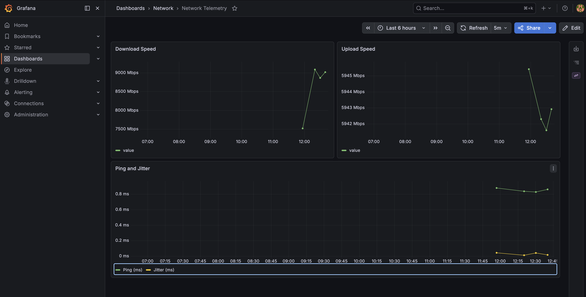
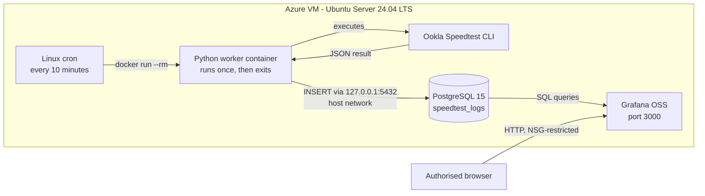
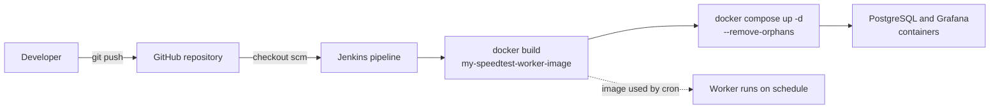
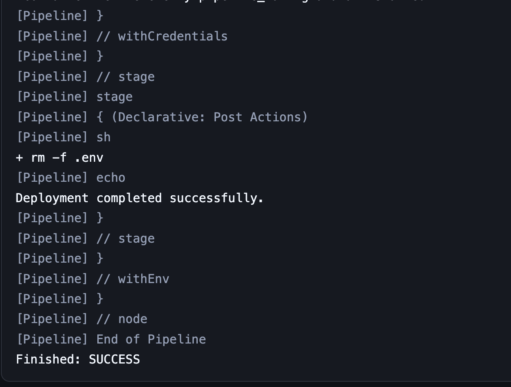
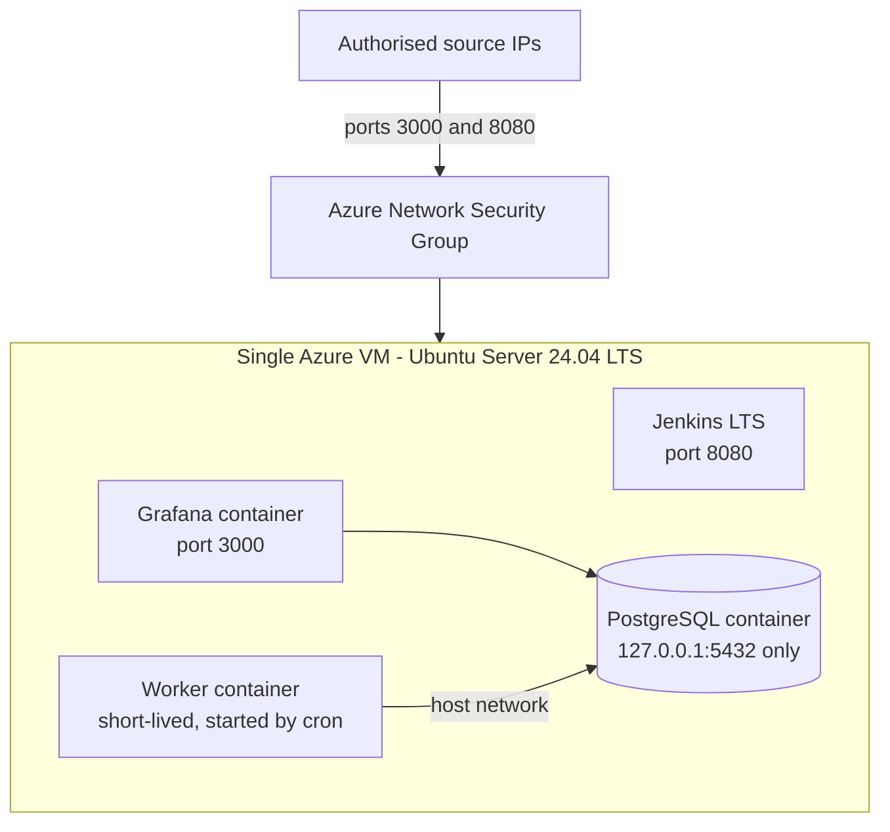
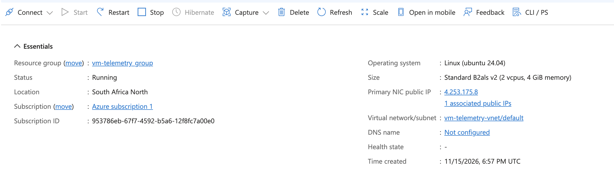

# Network Telemetry Pipeline


A small, deployed telemetry pipeline on a single Azure Ubuntu VM. Linux cron runs a containerised Python worker every 10 minutes. The worker takes an Ookla Speedtest measurement, stores it in PostgreSQL, and Grafana charts the history. Jenkins redeploys the stack from this repository.

> [!IMPORTANT]
> The Ookla tests run **from the Azure VM**. They measure the VM's own network connection, not a home or office internet line.



## Contents

1. [Project overview](#2-project-overview-and-objectives) · 2. [Key features](#3-key-features) · 3. [Technology stack](#4-technology-stack) · 4. [System architecture](#5-system-architecture) · 5. [Data workflow](#6-data-collection-and-processing-workflow) · 6. [CI/CD workflow](#7-cicd-workflow) · 7. [Database schema](#8-database-schema) · 8. [Grafana](#9-grafana-monitoring-and-dashboards) · 9. [Deployment architecture](#10-deployment-architecture) · 10. [Prerequisites](#11-prerequisites) · 11. [Local setup](#12-local-development-and-setup) · 12. [Azure deployment](#13-azure-deployment) · 13. [Jenkins](#14-jenkins-pipeline-configuration) · 14. [Configuration](#15-environment-variables-and-configuration) · 15. [Security](#16-security-considerations) · 16. [Cost](#17-cost-considerations) · 17. [Decisions](#18-challenges-and-engineering-decisions) · 18. [Future work](#19-future-improvements) · 19. [Author](#20-author-and-contact)

**Further reading:** [Architecture](docs/architecture.md) · [Operations guide](docs/operations.md)

---

## 2. Project Overview and Objectives

The project records download speed, upload speed, ping latency and jitter at a fixed interval and keeps the history in a database, so changes in network quality can be seen over time on a dashboard.

It was built to practise and demonstrate the full path from code to a running service:

- **Automate collection.** A short-lived container is started by cron, records one measurement and exits.
- **Keep infrastructure as code.** The database schema, Grafana data source, Grafana dashboard and deployment pipeline are all version-controlled in this repository.
- **Automate deployment.** A Jenkins pipeline builds the worker image and applies the Docker Compose stack from a Git checkout.
- **Handle secrets properly.** Credentials stay out of Git and are injected through an environment file and a Jenkins credential.
- **Limit exposure.** PostgreSQL listens on localhost only, and the Grafana and Jenkins ports are restricted by Azure Network Security Group (NSG) rules to authorised source IP addresses.

This is a single-VM project built for learning and demonstration. It is not a multi-node or high-availability system.

## 3. Key Features

- Scheduled measurements every 10 minutes through Linux cron
- Records download (Mbps), upload (Mbps), ping latency (ms), jitter (ms) and a timestamp
- Worker is not a long-running service: it runs, writes one row and exits
- A failed test exits with code 1 and writes no row, so a failure shows as a gap in the charts and not as a false zero
- PostgreSQL 15 with a time-indexed table and persistent Docker volume
- Grafana with the data source and a three-panel dashboard provisioned from files, no manual setup in the UI
- Jenkins pipeline: checkout, build worker image, deploy Compose stack, remove the temporary `.env`
- Secrets supplied through environment variables and a Jenkins Secret file credential

## 4. Technology Stack

| Layer | Technology | Why it was chosen |
| --- | --- | --- |
| Cloud | Microsoft Azure Virtual Machine, Ubuntu Server 24.04 LTS | A plain VM keeps the project close to real operations work: networking, firewalling, patching and service management. LTS gives a stable base. |
| Containers | Docker, Docker Compose | Reproducible services, one command to bring up the stack, named volumes for persistence. |
| Worker | Python 3.12 (`python:3.12-slim`), `psycopg2-binary` | A small script is enough for one job: run a CLI, parse JSON, insert a row. |
| Measurement | Ookla Speedtest CLI (installed from Ookla's package repository in the image) | Official CLI with machine-readable JSON output. |
| Database | PostgreSQL 15 (`postgres:15-alpine`) | Reliable relational store with time-based indexing and native Grafana support. |
| Visualisation | Grafana OSS (`grafana/grafana-oss`) | Provisioning files allow the data source and dashboard to live in Git. |
| CI/CD | Jenkins LTS, GitHub | Declarative `Jenkinsfile` keeps the deployment process in the repository. |
| Scheduling | Linux cron | Keeps the 10-minute loop on the host, independent of Jenkins and Docker Compose. |

## 5. System Architecture

Two flows run independently: the **data flow** (measurement to dashboard) and the **deployment flow** (code to running stack).



**Data flow:** Ookla Speedtest → Python worker → PostgreSQL → Grafana



**Deployment flow:** GitHub → Jenkins → Docker image build → Docker Compose deployment

The worker image is built by Jenkins but is **not** part of the Compose file. It is started only by cron, which is why it can exit after each run.

## 6. Data Collection and Processing Workflow

Implemented in `app/speedtest_logger.py`:

1. Cron starts a new worker container on the Azure VM.
2. The script runs `speedtest --accept-license --accept-gdpr --format=json` with a 120-second timeout.
3. It parses the JSON and reads download and upload bandwidth (bytes per second), ping latency and jitter.
4. Bandwidth is converted to Mbps with `bytes_per_second * 8 / 1_000_000`.
5. It connects to PostgreSQL using `DB_HOST`, `DB_NAME`, `DB_USER` and `DB_PASSWORD`.
6. It inserts one row into `speedtest_logs` inside a transaction. The `timestamp` column is filled by the database.
7. It prints `logged (...)` and exits with code 0.

If anything fails (CLI error, timeout, database error), the script prints `Speedtest failed: ...` to stderr and exits with code 1. No partial row is written.

**Why the worker connects through the host network:** the container runs with `--network host`, so it reaches PostgreSQL at `127.0.0.1:5432`. This lets PostgreSQL stay bound to localhost and never be published on a public interface.

## 7. CI/CD Workflow

The pipeline is defined in the [`Jenkinsfile`](Jenkinsfile):

| Stage | Action |
| --- | --- |
| Checkout | `checkout scm`, which fetches the repository configured on the Jenkins job |
| Build worker image | `docker build -t my-speedtest-worker-image ./app` |
| Deploy stack | Copies the `telemetry-env` Secret file credential to `.env`, then runs `docker compose up -d --remove-orphans` |
| Post (always) | Removes the temporary `.env` from the workspace |

Design notes:

- The deployment uses `docker compose up -d` and does **not** run `docker compose down`, so unchanged containers are not stopped on every deploy and the named volumes are untouched.
- Secrets are written to the workspace only for the duration of the run.
- Cron is not part of the pipeline, so the 10-minute measurement loop does not depend on Jenkins.



## 8. Database Schema

Defined in [`postgres/init.sql`](postgres/init.sql). The script uses `IF NOT EXISTS`, so it is safe to re-run.

| Column | Type | Description |
| --- | --- | --- |
| `id` | `SERIAL PRIMARY KEY` | Unique ID per measurement |
| `timestamp` | `TIMESTAMPTZ DEFAULT CURRENT_TIMESTAMP` | When the row was inserted (timezone-aware) |
| `download_speed` | `FLOAT` | Download speed in Mbps |
| `upload_speed` | `FLOAT` | Upload speed in Mbps |
| `ping` | `FLOAT` | Ping latency in milliseconds |
| `jitter` | `FLOAT` | Jitter in milliseconds |

An index, `idx_speedtest_timestamp`, on `timestamp` keeps the Grafana time-range queries fast as the table grows.

`init.sql` runs only when the PostgreSQL data volume is created for the first time. Changing the file later does not alter an existing database.

## 9. Grafana Monitoring and Dashboards

Grafana is configured entirely from files in `grafana/provisioning/`:

| File | Purpose |
| --- | --- |
| `datasources/datasource.yml` | Defines a PostgreSQL data source named `Telemetry` (uid `Telemetry`) pointing at `postgres:5432`, database `net_telemetry`. The password comes from the `POSTGRES_PASSWORD` environment variable. |
| `dashboards/dashboards.yml` | Loads dashboards from the provisioning folder into a Grafana folder named `Network`. |
| `dashboards/network_dashboard.json` | The **Network Telemetry** dashboard (uid `network-telemetry`), refreshing every 5 minutes. |

The dashboard has three time-series panels:

| Panel | Metric | Unit |
| --- | --- | --- |
| Download Speed | `download_speed` | Mbps |
| Upload Speed | `upload_speed` | Mbps |
| Ping and Jitter | `ping` and `jitter` | ms |

Each panel queries `speedtest_logs` with the Grafana `$__timeFilter(timestamp)` macro, so it follows the selected time range.

Because the dashboard is provisioned from Git, a Jenkins deploy restores the same dashboard on a fresh Grafana volume.

## 10. Deployment Architecture



PostgreSQL is published only on `127.0.0.1`, so it is unreachable from outside the VM even if a firewall rule were misconfigured.



**Repository layout**

```text
net-telemetry-pipeline/
├── app/
│   ├── Dockerfile
│   ├── requirements.txt
│   └── speedtest_logger.py
├── grafana/provisioning/
│   ├── dashboards/
│   │   ├── dashboards.yml
│   │   └── network_dashboard.json
│   └── datasources/datasource.yml
├── postgres/init.sql
├── docs/images/                 # screenshots referenced by this README
├── docker-compose.yml
├── Jenkinsfile
└── .gitignore
```

## 11. Prerequisites

- A Microsoft Azure subscription and permission to create a VM and Network Security Group rules
- An Ubuntu Server 24.04 LTS VM with SSH access
- Docker Engine and the Docker Compose plugin on the VM
- Jenkins LTS on the VM, with the Git, Pipeline and Credentials Binding plugins (the `Jenkinsfile` uses `checkout scm` and `withCredentials`)
- Your public IP address, to use as the allowed source in NSG rules
- A GitHub account with access to this repository

## 12. Local Development and Setup

The Compose stack (PostgreSQL and Grafana) and the worker can be tried on any Linux machine with Docker.

**1. Clone the repository**

```bash
git clone https://github.com/michaelnyandigisi/net-telemetry-pipeline.git
cd net-telemetry-pipeline
```

**2. Create a `.env` file** in the repository root defining two variables. It is excluded by `.gitignore`.

```text
POSTGRES_PASSWORD=<choose-a-strong-password>
GRAFANA_ADMIN_PASSWORD=<choose-a-different-strong-password>
```

**3. Start PostgreSQL and Grafana**

```bash
docker compose up -d
docker compose ps
```

**4. Build the worker image**

```bash
docker build -t my-speedtest-worker-image ./app
```

**5. Create a `.worker.env` file** (also excluded by `.gitignore`) for the worker:

```text
DB_HOST=127.0.0.1
DB_NAME=net_telemetry
DB_USER=admin
DB_PASSWORD=<same-value-as-POSTGRES_PASSWORD>
```

**6. Run one measurement**

```bash
docker run --rm --network host --env-file .worker.env my-speedtest-worker-image
```

Expected output is a line beginning with `logged`.

**7. Check the stored data and open Grafana**

```bash
docker compose exec postgres psql -U admin -d net_telemetry \
  -c "SELECT * FROM speedtest_logs ORDER BY timestamp DESC LIMIT 5;"
```

Grafana is at `http://localhost:3000`. The username is `admin` and the password is the `GRAFANA_ADMIN_PASSWORD` you set. The **Network Telemetry** dashboard appears in the **Network** folder.

> `--network host` behaves differently on Docker Desktop for macOS and Windows. The commands above are written for Linux hosts.

To tear down the local stack, run `docker compose down`. Add `-v` to also delete the database and Grafana volumes.

## 13. Azure Deployment

Replace placeholders such as `<vm-public-ip>` with your own values.

**1. Create the VM.** Choose Ubuntu Server 24.04 LTS, enable SSH key authentication, and size it for running Jenkins, Grafana and PostgreSQL together.

**2. Configure the Network Security Group.**

| Port | Service | Source |
| --- | --- | --- |
| 22 | SSH | Authorised IP addresses only (recommended) |
| 8080 | Jenkins | Authorised IP addresses only |
| 3000 | Grafana | Authorised IP addresses only |
| 5432 | PostgreSQL | **Not opened.** It is bound to localhost on the VM. |

**3. Install Docker Engine and the Compose plugin** on the VM by following the [official Docker instructions for Ubuntu](https://docs.docker.com/engine/install/ubuntu/), then confirm:

```bash
docker --version
docker compose version
```

**4. Install Jenkins LTS** by following the [official Jenkins Linux installation guide](https://www.jenkins.io/doc/book/installing/linux/), and let the `jenkins` user run Docker, since the pipeline calls `docker` directly:

```bash
sudo usermod -aG docker jenkins
sudo systemctl restart jenkins
```

**5. Configure the Jenkins job and credential** as described in [Jenkins Pipeline Configuration](#14-jenkins-pipeline-configuration), then run the first build. It builds `my-speedtest-worker-image` and starts PostgreSQL and Grafana.

**6. Create the worker settings file on the VM** with the four `DB_*` variables from [Environment Variables and Configuration](#15-environment-variables-and-configuration), readable only by the user that owns the crontab, for example:

```bash
chmod 600 <path-to-worker-env-file>
```

**7. Schedule the worker with cron.** Run `crontab -e` as that user and add:

```cron
*/10 * * * * /usr/bin/docker run --rm --network host --env-file <path-to-worker-env-file> my-speedtest-worker-image
```

The cron entry lives on the VM host, not in this repository. The user running it must be allowed to run Docker.

**8. Verify.** After 10 to 20 minutes, check that rows are arriving:

```bash
docker exec $(docker ps -qf name=postgres) psql -U admin -d net_telemetry \
  -c "SELECT count(*), max(timestamp) FROM speedtest_logs;"
```

Then open `http://<vm-public-ip>:3000` from an authorised IP address.

## 14. Jenkins Pipeline Configuration

1. **Add the credential.** In Jenkins, go to **Manage Jenkins → Credentials → Global → Add Credentials**. Choose kind **Secret file**, upload a `.env` file containing `POSTGRES_PASSWORD` and `GRAFANA_ADMIN_PASSWORD`, and set the ID to exactly `telemetry-env`. The `Jenkinsfile` refers to this ID.
2. **Create the job.** Create a **Pipeline** job and choose **Pipeline script from SCM**. Set SCM to Git, enter the repository URL, set the branch to `main`, and set the script path to `Jenkinsfile`.
3. **Add credentials for GitHub** only if the repository is private.
4. **Run the build.** Click **Build Now** and follow the **Console Output**.

The build trigger (manual, polling or webhook) is configured on the Jenkins job and is not stored in the repository.

## 15. Environment Variables and Configuration

| Variable | Used by | Set in | Purpose |
| --- | --- | --- | --- |
| `POSTGRES_PASSWORD` | PostgreSQL container, Grafana data source | `.env` (Jenkins credential `telemetry-env` on the VM) | Password for the `admin` database user |
| `GRAFANA_ADMIN_PASSWORD` | Grafana container | `.env` (same credential) | Grafana `admin` user password |
| `DB_HOST` | Worker | Worker env file, passed with `--env-file` | Database host; `127.0.0.1` with host networking |
| `DB_NAME` | Worker | Worker env file | Database name; `net_telemetry` |
| `DB_USER` | Worker | Worker env file | Database user; `admin` |
| `DB_PASSWORD` | Worker | Worker env file | Same value as `POSTGRES_PASSWORD` |

Fixed values in `docker-compose.yml`: database name `net_telemetry`, database user `admin`, Grafana admin user `admin`.

No secret values are stored in this repository. `.gitignore` excludes `.env` and `.worker.env`.

## 16. Security Considerations

**Implemented**

- **PostgreSQL is not public.** Port 5432 is published on `127.0.0.1` only.
- **Network access is restricted.** Grafana and Jenkins are reachable only from authorised source IPs through Azure NSG rules.
- **Credentials are kept out of Git.** The Compose file reads passwords from environment variables; Jenkins supplies them from a Secret file credential and deletes the temporary `.env` after every run.
- **Least running time for the worker.** It is not a persistent service, so there is no long-running process to attack or leak.
- **Parameterised SQL.** The worker passes values as query parameters.

**Known limitations**

- Grafana is served over plain HTTP on port 3000, with no TLS termination in this repository.
- The Jenkins user needs Docker access to run the pipeline, which is effectively root-level access on the VM. This is one reason Jenkins must stay IP-restricted.
- The worker and Grafana connect as the `admin` database user and not as separate, least-privilege roles.
- The Grafana image uses the `latest` tag, so upgrades are not pinned.
- The Dockerfile installs the Ookla CLI by piping Ookla's repository setup script into `bash` at build time.

## 17. Cost Considerations

- The whole system runs on **one Azure VM**; there are no managed database, load balancer or monitoring services to pay for.
- VM size, OS disk and outbound data are the main cost drivers. Check current Azure pricing and any free-tier allowance for your account before choosing a size.
- Every speed test moves data over the network. Running every 10 minutes is 144 tests per day, so the interval is the main lever for data transfer. Lengthen it if bandwidth costs matter.
- Running Jenkins, Grafana and PostgreSQL on one VM trades isolation for lower cost.

## 18. Challenges and Engineering Decisions

| Decision | Why | Trade-off |
| --- | --- | --- |
| Run the schedule with host cron, not Jenkins | The measurement loop keeps running if Jenkins is down, and Jenkins stays a deployment tool only | The cron entry is configured on the host and is not versioned in the repository |
| Short-lived worker container with `--rm` | Each run starts clean, uses no resources between runs and cannot leak state | Image must exist on the host before cron fires |
| Host networking for the worker | Lets the worker reach PostgreSQL on `127.0.0.1` while the database stays off public interfaces | Host networking removes container network isolation for the worker |
| Bind PostgreSQL to `127.0.0.1` | Removes the database from the public attack surface | Remote database tools must use an SSH tunnel |
| Secrets through `.env` and a Jenkins Secret file | Keeps credentials out of Git while still allowing automated deploys | Secrets still sit in Jenkins and in a file on the VM; a secrets manager would be stronger |
| `docker compose up -d` instead of `down` then `up` | Avoids needless downtime on each deploy and leaves volumes alone | Containers are recreated only when their configuration changes |
| Provision Grafana from files | Data source and dashboard are reviewable, reproducible and survive a rebuilt volume | Dashboard changes made in the UI must be exported back to the JSON file |
| Convert bandwidth to Mbps in the worker | Stored data is in the units shown on the dashboard | Raw bytes-per-second values are not kept |
| `IF NOT EXISTS` in `init.sql` | Safe to run more than once | The script runs only on first volume creation, so later schema changes need a manual migration |

## 19. Future Improvements

These are not implemented yet:

- Pin the Grafana image to a specific version
- Use separate least-privilege database roles for the worker (insert only) and Grafana (read only)
- Put Grafana behind HTTPS with a reverse proxy
- Add automated PostgreSQL backups and a data retention policy
- Add Grafana alerting for failed or slow measurements
- Add a webhook or polling trigger to the Jenkins job and version the cron entry (for example through a deployment script)
- Describe the Azure resources as code with Terraform or Bicep
- Add automated tests for the worker and a lint stage in the pipeline
- Add a worker variant that runs on-site, to measure a home or office connection instead of the Azure VM
- Move secrets to Azure Key Vault

## 20. Author and Contact

**Michael Nyandigisi**

- GitHub: [michaelnyandigisi](https://github.com/michaelnyandigisi)
- LinkedIn: _add link_
- Email: _add address_