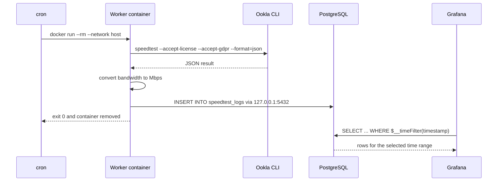
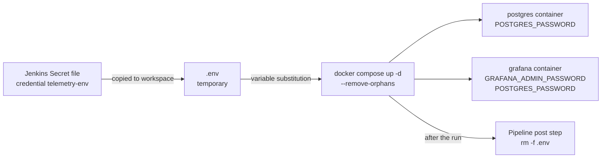

# Architecture

This document goes deeper than the [README](../README.md) on how the pieces fit together. Everything described here runs on a single Azure Ubuntu VM.

> The Ookla tests run from the Azure VM, so they measure the VM's own network connection, not a home or office line.

## Components

| Component | Runs as | Started by | Lifetime |
| --- | --- | --- | --- |
| Python worker (`app/speedtest_logger.py`) | Docker container from `my-speedtest-worker-image` | Linux cron, every 10 minutes | Seconds: runs one test, inserts one row, exits |
| PostgreSQL 15 | Docker Compose service `postgres` | Jenkins deploy (`docker compose up -d`) | Long-running, `restart: always` |
| Grafana OSS | Docker Compose service `grafana` | Jenkins deploy | Long-running, `restart: always` |
| Jenkins LTS | Service on the VM host | Operating system | Long-running |
| Cron | Host scheduler | Operating system | Long-running |

The worker image is built by Jenkins but is **not** defined in `docker-compose.yml`. Only cron starts it.

## One measurement, end to end

If the CLI fails, times out after 120 seconds, or the database is unreachable, the worker prints an error to stderr and exits with code 1. No row is written, so the dashboards show a gap.

## Deployment and secrets flow

Secrets live in three places only: the Jenkins credential, the worker's environment file on the VM, and inside the running containers' environment. None are in Git; `.gitignore` excludes `.env` and `.worker.env`.

## Network exposure

| Port | Service | Reachable from | Control |
| --- | --- | --- | --- |
| 8080 | Jenkins | Authorised source IPs | Azure NSG rule |
| 3000 | Grafana | Authorised source IPs | Azure NSG rule |
| 5432 | PostgreSQL | The VM itself only | Published on `127.0.0.1` in `docker-compose.yml`, no NSG rule |
| 22 | SSH | Administration | Azure NSG rule |

The worker uses the Docker host network, so it connects to PostgreSQL at `127.0.0.1:5432`. Grafana connects over Docker's internal Compose network using the service name `postgres:5432`.

## Data model

One table, `speedtest_logs`, defined in `postgres/init.sql`:

| Column | Type | Unit |
| --- | --- | --- |
| `id` | `SERIAL PRIMARY KEY` | n/a |
| `timestamp` | `TIMESTAMPTZ DEFAULT CURRENT_TIMESTAMP` | Insert time |
| `download_speed` | `FLOAT` | Mbps |
| `upload_speed` | `FLOAT` | Mbps |
| `ping` | `FLOAT` | ms |
| `jitter` | `FLOAT` | ms |

The index `idx_speedtest_timestamp` supports Grafana's time-range queries. At one test every 10 minutes the table gains 144 rows per day.

## Grafana provisioning

| File | What it defines |
| --- | --- |
| `grafana/provisioning/datasources/datasource.yml` | PostgreSQL data source `Telemetry` (uid `Telemetry`), database `net_telemetry`, password from `POSTGRES_PASSWORD` |
| `grafana/provisioning/dashboards/dashboards.yml` | File provider that loads dashboards into the `Network` folder |
| `grafana/provisioning/dashboards/network_dashboard.json` | Dashboard `Network Telemetry` (uid `network-telemetry`): Download Speed, Upload Speed, Ping and Jitter |

The dashboard refers to the data source by uid `Telemetry`, which matches `datasource.yml`. Renaming the uid in one place without the other breaks the panels.

## Design decisions

The reasoning behind the main choices, with trade-offs, is in the README section [Challenges and Engineering Decisions](../README.md#18-challenges-and-engineering-decisions).

## Known limitations

- Single VM: no redundancy. If the VM is down, no measurements are taken.
- Grafana is served over plain HTTP.
- The worker and Grafana use the `admin` database user.
- The cron entry and the worker settings file exist only on the VM and are not versioned.
- Backups and data retention are not automated.
